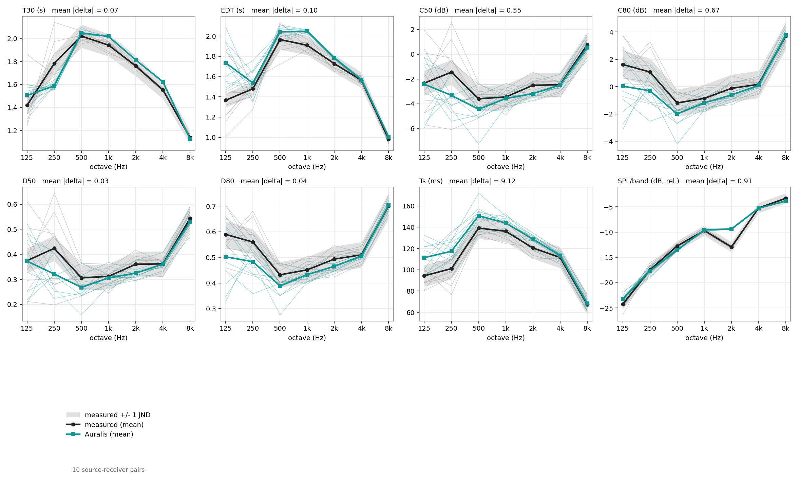

# CR2: seminar room (small room, scene 09)

Seminar room, dodecahedron source, 2 positions × 5 microphones = 10 pairs. Data: BRAS database
(doi.org/10.14279/depositonce-6726), scene 09, TU Berlin, CC BY-SA 4.0 (`../LICENSE.md`). This
page also defines the metric that CR1, CR3 and CR4 use.

## Metric

Errors are counted in JND (the smallest audible difference): 5 % for T30, 1 dB for C50 and
level, 10 ms for Ts. The score is the mean of |error| / JND over these four parameters, the
octaves 125 Hz-8 kHz and the pairs. The share is the part of the (parameter, band) couples
within 1 JND. Parameters use the omni response, like the BRAS microphone, in true octave bands.

## Results

| Run | Reading | Mean | ≤ 1 JND | T30 | C50 | Ts | Level |
|---|---|---|---|---|---|---|---|
| `reference_run/` (2026-11-10) | published | **1.09** | **67 %** | 1.11 | 1.10 | 1.01 | 1.14 |
| `reference_run_2026-11-10_flatwave/` | no source spectrum in the wave band | 1.07 | 68 % | 1.10 | 1.10 | 1.01 | 1.06 |
| `reference_run_ears/` | ears, older default | 1.15 | 61 % | 1.09 | 1.16 | 0.96 | 1.41 |

- **Published:** omni metrics and the current engine defaults: size-dependent scattering
  (`rbs_scattering`, exact against image sources and radiosity,
  `../../tools/ga_reference_box.py`), a 16 Hz subsonic cut on the wave band, and the speed of
  sound of humid air (Cramer).
- **Source spectrum:** the wave band radiates the power per octave of the source table
  (+0.91 / +0.28 / +0.27 dB at 125 / 250 / 500 Hz), like the geometrical solver. Without it,
  it radiates the power of the 1 kHz band. This is an engine fix, not a fit.
- **Ears:** the mean of the two ears of a binaural render, with the older default.

## Main remaining error: level at 2 kHz

With omni metrics, the only systematic level error is +3.0 to +3.6 dB at 2 kHz, in CR2, CR3 and
CR4. Two BRAS campaigns disagree there. The unit spectra of the dodecahedron give −3.1 dB at
2 kHz re 1 kHz (the bench matches them within 0.1 dB). In the room sessions, the simulated
direct sound is 3.7 to 4.7 dB above the measured one. 2 kHz is just above the source
crossover (1.42 kHz), so the campaigns probably used different crossover settings.

Calibrating on the direct sound would give 0.96 / 1.44 / 1.83 JND (CR2 / CR3 / CR4) instead of
1.08 / 1.51 / 1.90 (engine of 2026-11-05). That would fit the source to the measurements being
judged, so the BRAS source data is kept, uncorrected, on purpose. `../bras_dodeca_check.py`
reproduces the analysis.



## Reproduce

To run the bench on the geometry and manifest of this folder:

```bash
python3 BRAS/CR2/cr2_run.py BRAS/CR2/cr2_dodecahedron_fitted31_dir.json -o out
python3 BRAS/bras_jnd.py out/report.csv
```

From the raw data:

1. Data: BRAS database (doi.org/10.14279/depositonce-6726), scene 09.
   Unpacked folder = `<DATA>` (contains `Geometry/`, `RIRs/`).
2. OBJ: convert `Geometry/scene9_RIR_Dodecahedron.skp` to `.obj`
   (e.g. https://convert3d.org/convert/skp) → `<DATA>/CR2_RIR.obj`. The published OBJ was made
   this way. `../skp_to_obj.py --keep mat_CR2_` also gives the 5 official areas, but no
   published run uses it yet.
3. Relabel and check (restores Z-up, spreads the materials):
```bash
cd <repo>/BRAS/CR2
python3 relabel_cr2_obj.py <DATA>/CR2_RIR.obj <DATA>/CR2_RIR_fixed.obj
python3 check_obj_areas.py <DATA>/CR2_RIR_fixed.obj --ref cr2   # 5 areas OK?
```
4. Manifest: copy the template, then add the 10 pairs from the SOFA file ("10 pairs
   injected"). The materials come from the BRAS `fitted_estimates` CSVs, never re-fitted.
```bash
cd <DATA>
cp <repo>/BRAS/manifests/cr2_dodecahedron_fitted31.json my_cr2.json
python3 <repo>/BRAS/sofa_pairs.py RIRs/*Dodecahedron.sofa \
    --into my_cr2.json \
    --pattern "RIRs/wav/scene9_RIR_{emitter}_{receiver}_Dodecahedron.wav"
```
5. Run (GPU recommended, with the `_fixed` OBJ). It writes `out/report.csv`, `report.txt`
   and `out/validation.png`.
```bash
python3 <repo>/BRAS/CR2/cr2_run.py my_cr2.json -o out
```
   To plot again: `python3 <repo>/BRAS/CR2/plot.py out/report.txt -o out/validation.png`.

## Listening test

```bash
webapp/.venv/bin/python BRAS/CR2/listening_test.py      # ~15 min on the GPU (needs h5py)
# --quick: no wave band, 20k rays, to test the chain; --no-session-fit: see below
webapp/.venv/bin/python BRAS/CR2/listening_test.py --set voice   # speech and isolated events
```

The test compares the measured binaural responses of BRAS (FABIAN head at MP6, QSC-K8 speaker
at LS3-LS7) with simulated ones, on headphones. It writes a self-contained page,
`listening_out/listening_test.html`, with "which one is real?" and ABX trials. `--set voice`
uses Odeon anechoic recordings under a local research licence, so its page must not leave the
machine. Labelled exception: the binaural session decayed about 12 % faster than the omni
session. For this test only, a uniform absorption per octave corrects the room
(`--no-session-fit` keeps the published materials).

## Files

- `cr2_run.py`: the room bench (CR1 to CR4). `plot.py`, `figures/`: the figures.
- `relabel_cr2_obj.py`, `check_obj_areas.py`: geometry fix and area check.
- `cr2_dodecahedron_*.json`: manifests. `*_directivity.json`: source directivities.
- `listening_test.py`, `listening_test_page.html`: the listening test.
- `binaural_lowband.py`, `binaural_lowband_run/`: binaural low end of the wave band.
- `reference_run_ears/report_engine_bands.*`: the ears run on the old engine bands.
- Earlier runs: `reference_run_2026-11-06/` (dry-air speed of sound),
  `reference_run_2026-11-04/` (no subsonic cut), `run_omni/` (older default), `run_omni_est/`
  and `run_estimator/` (corrected estimator only), `run_ism3/` (image sources of order 3).
