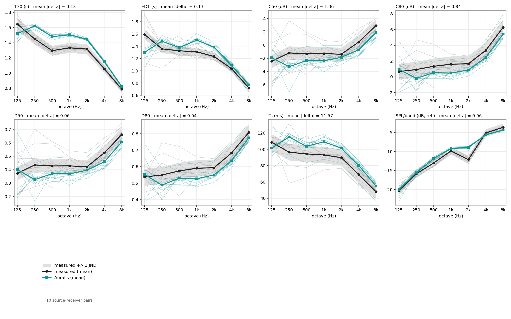

# CR3: chamber music hall (medium room)

Small hall of the Konzerthaus Berlin, 3330.6 m³. Dodecahedron source, 2 positions × 5
microphones = 10 pairs. Same metric and JND as CR2 (`../CR2/README.md`). Data: BRAS, TU Berlin,
CC BY-SA 4.0 (`../LICENSE.md`).

## Results

| Run | Reading | Mean | ≤ 1 JND | T30 | C50 | Ts | Level |
|---|---|---|---|---|---|---|---|
| `reference_run/` (2026-11-10) | published | **1.51** | **40 %** | 1.98 | 1.55 | 1.29 | 1.19 |
| `reference_run_2026-11-10_flatwave/` | no source spectrum in the wave band | 1.49 | 40 % | 1.97 | 1.56 | 1.29 | 1.15 |
| `reference_run_ears/` | ears, older default | 1.85 | 38 % | 3.34 | 1.51 | 1.30 | 1.26 |
| `run_initial_omni/` | blind initial materials | 2.87 | 26 % | 5.30 | 1.82 | 2.44 | 1.92 |

The readings are defined in CR2.



## Main remaining error: T30 too long

The simulated T30 is 10-14 % too long from 250 Hz to 2 kHz. Means over the 10 pairs:

| T30 (s) | 500 Hz | 1 kHz | 2 kHz |
|---|---|---|---|
| measured | 1.30 | 1.33 | 1.32 |
| Eyring, fitted materials, with air | 1.28 | 1.33 | 1.32 |
| simulated, `reference_run/` | 1.47 | 1.50 | 1.44 |

- **The fitted materials are an Eyring calibration.** BRAS matched them to the measured T30
  with Eyring's formula, which assumes a diffuse field. On our model, Eyring with ISO 9613-1 air
  gives the measurement within 3 % from 250 Hz to 4 kHz
  (`../bras_eyring.py manifest.json report.csv`).
- **Here the absorption is concentrated on the seating, and the BRAS wall scattering is low.**
  Long specular paths survive, and the geometrical simulation decays 17-25 % slower than Eyring
  (older default). In CR2, with spread absorption, it stays within 3 %.
- **The T30 cannot settle the cause.** The engine is exact for a given scattering
  (`../../tools/ga_reference_box.py`), and the seats get their share of the late energy
  (`../../tools/late_field_hits.py`). So a more diffuse real field and seats that absorb more
  than their calibrated value give the same T30. We do not add scattering to match it.
- **Other engines do the same.** In the 2019 round robin (Brinkmann et al., JASA 145), the
  engines landed "closer to the Eyring estimates than to the measured values". With the blind
  materials, our T30 errors have their profile: too long in the bass, right in the middle, too
  short in the treble.

## Level at 2 kHz

The level is +3.0 to +3.6 dB too high at 2 kHz, as in CR2 and CR4. Two BRAS campaigns disagree
on the source output there. It is not corrected, on purpose. Calibrating on the direct sound
would give 1.44 JND instead of 1.51, but that would fit the source to the measurements being
judged. See `../CR2/README.md`.

## Reproduce

BRAS gives the geometry only as a SketchUp 2015 file. `../skp_to_obj.py` converts it and keeps
the material of each face. The first command needs a Python environment with the OpenSKP
reader (MIT).

```bash
python -I BRAS/skp_to_obj.py \
    "data_bras/1 Scene descriptions/CR3 medium room (chamber music hall)/Geometry/CR3_RIR_Dodecahedron.skp" \
    BRAS/CR3/CR3_RIR.obj --keep mat_CR3_
webapp/.venv/bin/python BRAS/bras_room_manifest.py CR3 --obj CR3_RIR.obj \
    -o BRAS/CR3/cr3_dodecahedron_fitted31_dir.json            # --estimates initial
python3 BRAS/CR2/cr2_run.py \
    BRAS/CR3/cr3_dodecahedron_fitted31_dir.json -o BRAS/CR3/reference_run
python3 BRAS/bras_jnd.py BRAS/CR3/reference_run/report.csv
```

About 8 minutes on the GPU (automatic crossover 187 Hz). The figure needs matplotlib:
`../CR2/plot.py report.txt -o fig.png`.

## Files

- `CR3_RIR.obj`: the geometry. Its 7 areas match the official ones (`mat_CR3.txt`) to 0.01 m².
- `cr3_dodecahedron_fitted31_dir.json`, `cr3_dodecahedron_initial31_dir.json`: manifests,
  fitted and blind. The other `cr3_*.json` are earlier variants.
- Earlier runs: `reference_run_2026-11-06/` (dry-air speed of sound),
  `reference_run_2026-11-04/` (no subsonic cut), `run_omni/` (older default), `run_omni_est/`
  and `run_estimator/` (corrected estimator only), `run_rbs/` (size-dependent scattering),
  `run_initial/` (blind, ears), `run_ism3/` (image sources of order 3).
- `figures/`: the validation figures.
