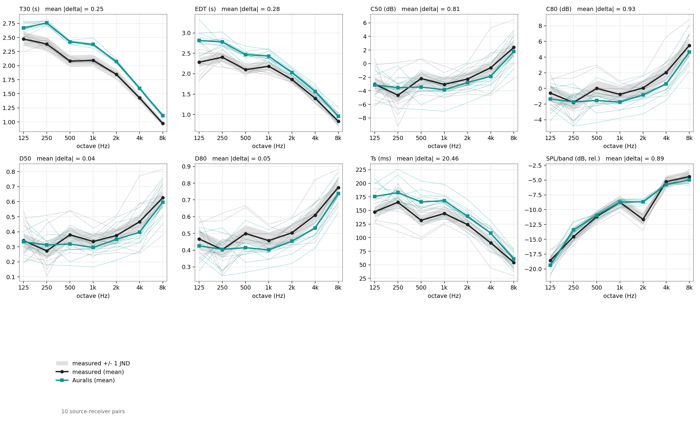

# CR4: auditorium (large room)

Auditorium of 8 656.5 m³. Dodecahedron source, 2 positions × 5 microphones = 10 pairs. Same
metric and JND as CR2 (`../CR2/README.md`). Data: BRAS, TU Berlin, CC BY-SA 4.0
(`../LICENSE.md`).

## Results

| Run | Reading | Mean | ≤ 1 JND | T30 | C50 | Ts | Level |
|---|---|---|---|---|---|---|---|
| `reference_run/` (2026-11-10) | published | **1.86** | **37 %** | 2.63 | 1.65 | 2.19 | 1.00 |
| `reference_run_2026-11-10_flatwave/` | no source spectrum in the wave band | 1.89 | 34 % | 2.66 | 1.65 | 2.23 | 1.03 |
| `reference_run_ears/` | ears, older default | 2.06 | 26 % | 2.94 | 1.73 | 2.38 | 1.21 |
| `run_initial_omni/` | blind initial materials | 2.31 | 25 % | 3.19 | 1.97 | 2.52 | 1.57 |

The readings are defined in CR2. With the ears, Ts and C50 also looked off at mid frequencies, but this came from
the ears reading and the slow decay, not from missing early energy.



## Main remaining error: T30 too long

The simulated T30 is 12-16 % too long from 250 Hz to 2 kHz. Means over the 10 pairs:

| T30 (s) | 125 | 250 | 500 | 1k | 2k | 4k | 8k |
|---|---|---|---|---|---|---|---|
| measured | 2.47 | 2.38 | 2.08 | 2.09 | 1.85 | 1.43 | 0.97 |
| Eyring, fitted materials, with air | 2.31 | 2.40 | 2.09 | 2.10 | 1.87 | 1.41 | 0.82 |
| simulated, `reference_run/` | 2.65 | 2.76 | 2.43 | 2.37 | 2.07 | 1.60 | 1.11 |

This is the CR3 finding again (`../CR3/README.md`):

- From 250 Hz to 4 kHz, the measurement is within 1 % of Eyring on the fitted materials, with
  ISO 9613-1 air. These materials are an Eyring calibration
  (`../bras_eyring.py cr4_dodecahedron_fitted31_dir.json reference_run/report.csv`).
- The seating carries 26-33 % of the absorption on 10 % of the surface (CR3: 17 % on 6 %). In
  CR2, each material's share of the absorption equals its share of the surface. With the older
  default, the simulation decays slower than Eyring by +3-4 % in CR2, +16-24 % in CR3 and
  +11-19 % in CR4. Uneven
  absorption breaks the diffuse-field assumption of Eyring. This is plausible, but these three
  rooms alone do not prove it.
- The BRAS wall scattering is low, so long specular paths survive. Size-dependent scattering
  barely helps here, because the surfaces of this auditorium are large. We do not add
  scattering to match the measurement.

## Level at 2 kHz

The level is +3.0 to +3.6 dB too high at 2 kHz, as in CR2 and CR3. Two BRAS campaigns disagree
on the source output there. It is not corrected, on purpose. Calibrating on the direct sound
would give 1.83 JND instead of 1.90, but that would fit the source to the measurements being
judged. See `../CR2/README.md`.

## Reproduce

BRAS gives the geometry only as a SketchUp 2015 file with text labels, which need OpenSKP 1.5.0
or later (1.3.0 fails with "class-ref to non-class slot (CText)"). The first command needs a
Python environment with that reader (MIT). The 8 areas per material match
`data_bras/3 Surface descriptions/_descr/mat_CR4.txt` to 0.01 m².

```bash
python -I BRAS/skp_to_obj.py \
    "data_bras/1 Scene descriptions/CR4 large room (auditorium)/Geometry/CR4_RIR_Dodecahedron.skp" \
    BRAS/CR4/CR4_RIR.obj --keep mat_CR4_
webapp/.venv/bin/python BRAS/bras_room_manifest.py CR4 --obj CR4_RIR.obj \
    -o BRAS/CR4/cr4_dodecahedron_fitted31_dir.json            # --estimates initial
python3 BRAS/CR2/cr2_run.py \
    BRAS/CR4/cr4_dodecahedron_fitted31_dir.json -o BRAS/CR4/reference_run
python3 BRAS/bras_jnd.py BRAS/CR4/reference_run/report.csv
```

About 5 minutes on the GPU (automatic crossover 141 Hz). The engine warns that the parquet's
wall filter was active on the grid, and repairs it (passivity check). `--reuse` judges the
saved `*_sim.wav` files again without running the engine. The figure needs matplotlib:
`../CR2/plot.py report.txt -o fig.png`.

## Files

- `CR4_RIR.obj`: the geometry.
- `cr4_dodecahedron_fitted31_dir.json`, `cr4_dodecahedron_initial31_dir.json`: manifests,
  fitted and blind. The other `cr4_*.json` are earlier variants.
- Earlier runs: `reference_run_2026-11-06/` (dry-air speed of sound),
  `reference_run_2026-11-04/` (no subsonic cut), `run_omni/` (older default), `run_omni_est/`
  and `run_estimator/` (corrected estimator only), `run_rbs/` (size-dependent scattering),
  `run_initial/` (blind, ears), `run_ism3/` (image sources of order 3).
- `figures/`: the validation figures.
