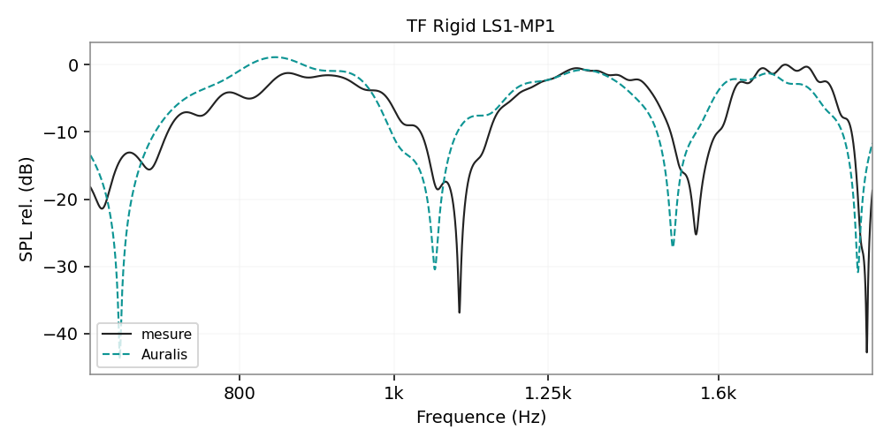
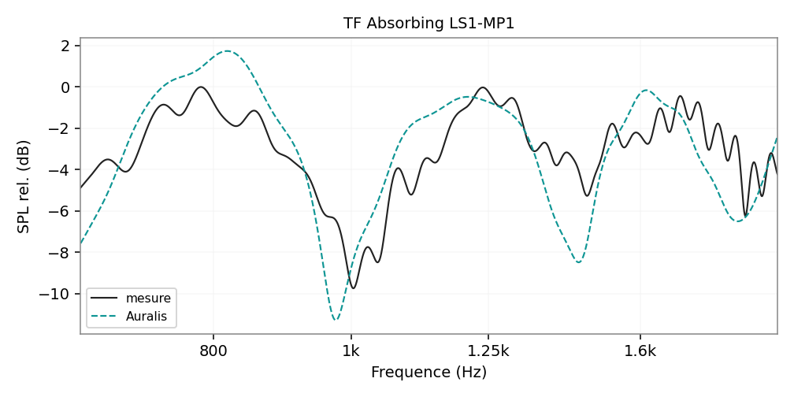
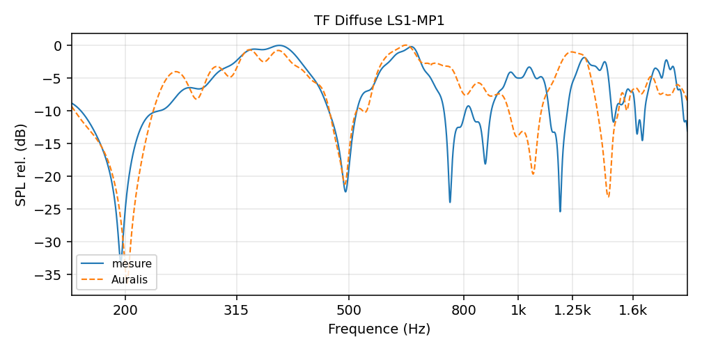
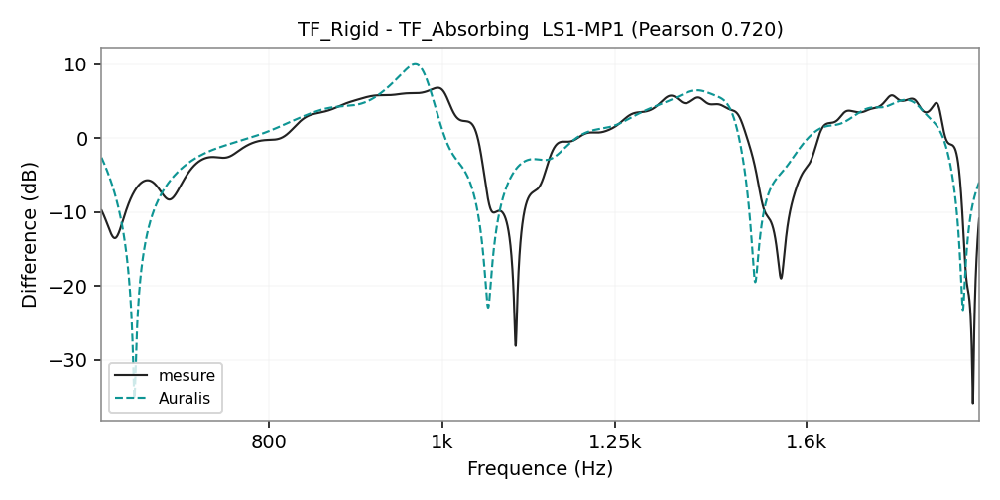
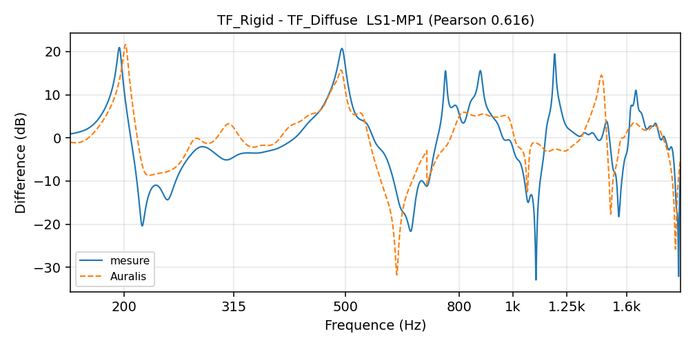

# RS1: reflection from an infinite plane

One floor in three states: bare (**Rigid**), covered with 20 mm of Rockfon
(**Absorbing**), or with a 1-D diffuser of 33 slats (**Diffuse**).

## Metric

For each source-microphone pair, we take the difference of the transfer
functions (TF) between two states (Rigid−Absorbing, Rigid−Diffuse). This
cancels the response and the directivity of the source. The score is the
Pearson correlation with the BRAS measurement over 160-2000 Hz. The simulation
has two tiers, each with its own grid: low (160-700 Hz) and high
(700-2000 Hz).

## Result (published configuration, run of 2026-11-06)

Mean: **0.658** for the absorber (Treble publishes 0.63), **0.511** for the
diffuser. Most of the error is in the high tier of the diffuser.

| Difference | Pair | Low 160-700 Hz | High 700-2000 Hz | 160-2000 Hz |
|---|---|---|---|---|
| Rigid−Absorbing | LS1-MP1 | 0.747 | 0.670 | 0.689 |
| Rigid−Absorbing | LS2-MP1 | 0.470 | 0.690 | 0.651 |
| Rigid−Absorbing | LS3-MP1 | 0.772 | 0.609 | 0.634 |
| Rigid−Diffuse | LS2-MP4 | 0.762 | 0.603 | 0.668 |
| Rigid−Diffuse | LS1-MP1 | 0.821 | 0.405 | 0.580 |
| Rigid−Diffuse | LS2-MP1 | 0.659 | 0.469 | 0.549 |
| Rigid−Diffuse | LS3-MP1 | 0.659 | 0.082 | 0.247 |

The Rockfon wall uses the complex fit of `fdtd.fit_physical_wall`. Older
figures (0.696 and 0.538, published until 2026-11-05) are wrong. They came
from a cache made before a fix of the subgrid fallback. With the fix, the low
tier is identical and the high tier is 0.03-0.06 lower.

## The published configuration is not converged

The published run puts the low tier at fc 800. Its 2 kHz tier falls back to a
factor-2 subgrid. Finer grids give other results:

- **Setting A**: low tier fc 1600, high tier fc 2000, factor-3 subgrid
  (`AURALIS_SUBGRID_MAX=4000`).
- **Setting B (converged)**: low tier fc 1600, high tier fc 4000, still judged
  from 160 Hz to 2 kHz.

| Correction | A: absorbing / diffuse | B: absorbing / diffuse | Diffuse low tier, fc 800 → 1600 |
|---|---|---|---|
| default (published 0.658 / 0.511) | 0.550 / 0.257 | 0.539 / 0.222 | 0.73 → 0.18 |
| anisotropic | 0.701 / 0.328 | 0.629 / 0.264 | 0.60 → 0.16 |
| staircase (conformal off) | 0.797 / 0.294 | 0.682 / 0.228 | 0.11 → 0.05 (0.055 at fc 2400) |

- The 0.66-0.82 low tier of the diffuser with the default correction comes
  from the coarse grid. Once converged, every correction gives 0.1-0.2 there.
- The default's 2 kHz tier depends on its subgrid factor. The absorber gives
  0.48-0.53 at factor 3 and 0.61-0.69 at factor 2.
- At fc 4000 the three corrections come closer (about 0.55-0.7 for the
  absorber). The lead of the staircase at fc 2000 was too optimistic.
- Once converged, the anisotropic correction beats the default on both
  conditions. None reproduces the diffuser. Its error comes from the slat
  model (hollow MDF profiles) or the measurement, not from the correction.

The published configuration stays until a decision on RS1.

## Run

1. Data: the scene 01 folder of the BRAS database (DepositOnce), the one with
   `RIRs/`. The material fit also needs the `_csv/initial_estimates/` of the
   surfaces (Rockfon).
2. From that scene folder:
```bash
python3 <repo>/BRAS/RS1/rs1_reflection.py . \
  --pairs LS2-MP4 LS1-MP1 LS2-MP1 LS3-MP1 \
  --conditions Rigid Absorbing Diffuse \
  --two-tier --max-cells 40000000 --margin 1.3 --out out_rs1
```
   A GPU is recommended. Each run is a subprocess with an npz cache, so the
   same command resumes after a crash. Output: `out_rs1/report.txt` and
   `report.csv` (Pearson and RMS per difference, pair and tier, as for CR2),
   plus the `TF_*` and `DIFF_*` figures (shared `bras_style`).
3. Add `--report-only` to rebuild the report and figures without computing.
   Pairs missing from the cache are skipped with a warning.

## Files

- `rs1_reflection.py`: the harness. It calls the shared `BRAS/bras_simple.py`.
- `reference_run/`: the published run (npz cache, report, logs). Replay it
  with `--out reference_run --report-only`.
- `figures/`: the figures below.

## Figures

Illustration (160-660 Hz band, fc=700):






