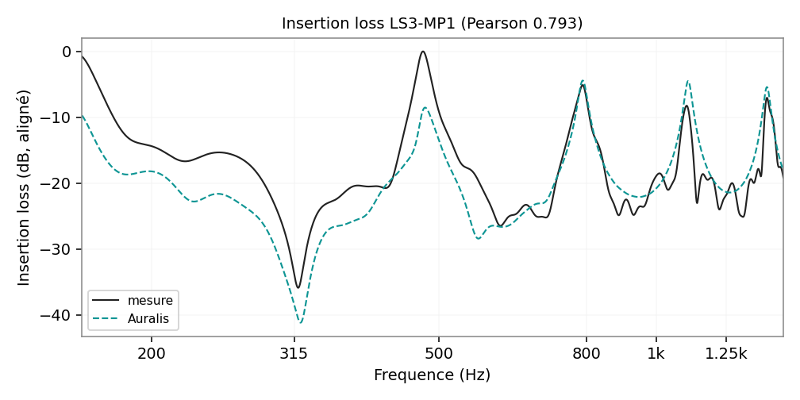
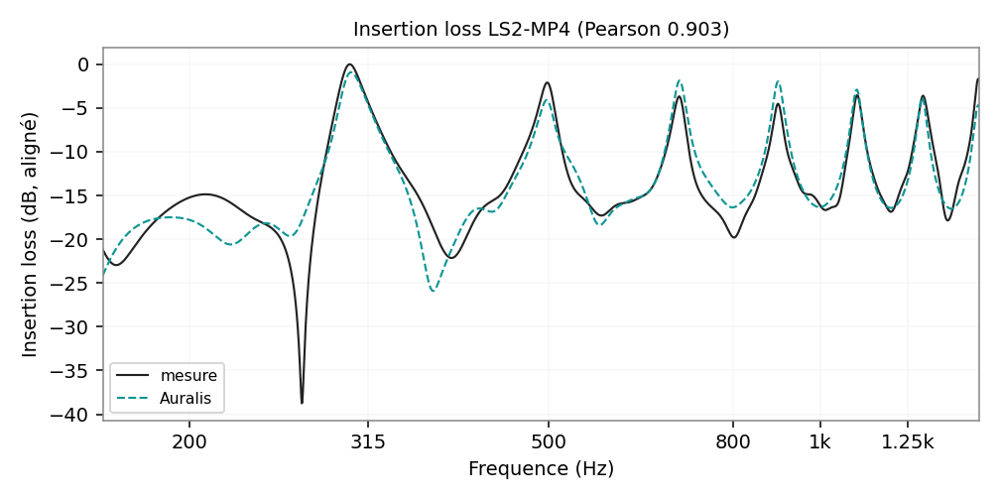
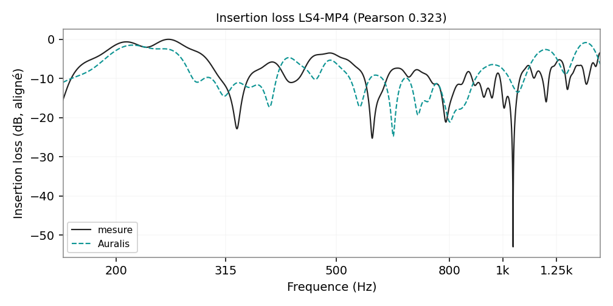

# RS5: edge diffraction (scene 05)

A thin 25 mm MDF screen on a rigid floor, in a hemi-anechoic chamber. Its
diffracting edge is at z = 2.066 m. 16 source-microphone pairs, from deep
shadow (microphone 6 mm above the floor) to the lit zone (above the edge).

## Metric

BRAS measured one condition, so we judge the **insertion loss**:
`TF(screen) − TF(free field)`. The free field is computed with the measured
Genelec 8020c directivity. Score: Pearson over 160-1500 Hz. The stricter
absolute TF is also given.

## Result

Three methods, none wins on its own:

| Method | **Insertion loss** | Absolute TF |
|---|---|---|
| Wave FDTD | 0.56 | 0.39 |
| Geometrical UTD | 0.68 | 0.31 |
| **Hybrid (FDTD below 700 Hz, UTD above)** | **0.71** | 0.52 |

- The FDTD captures the coupling of direct sound, floor and edge (the comb).
  But RAM caps fc at 1000 Hz, so it is under-resolved.
- The UTD gives the pure diffraction envelope. It is best in deep shadow but
  misses the comb.
- The 700 Hz crossover comes from physics, not from the target. The hybrid
  beats the FDTD for any crossover from 400 to 1000 Hz (0.47-0.51).

Main remaining error: the very deep shadow (LS4-MP4, 0.32). There,
subtracting the free field loses its meaning.

## Run

Data: the official BRAS dump in `data_bras/`, scene
"RS5 diffraction (infinite wedge)". One command replays everything
(finite-screen FDTD, UTD, hybrid, narrowband and third-octave insertion loss):
```bash
python3 <repo>/BRAS/RS5/run.py            # all 16 pairs
python3 <repo>/BRAS/RS5/run.py --quick    # 2 pairs, checks the chain
```
GPU recommended. Each run is a subprocess with an npz cache, so re-running
resumes after a crash. Each step writes `report.txt`, `report.csv` and its
figures.

## Files

- `run.py` calls `rs5_diffraction_edge.py` (FDTD, also holds `load_sofa5`,
  used by every scene), `rs5_diffraction_utd.py` (UTD), and the shared
  `BRAS/bras_insertion_loss.py --geom rs5` and `BRAS/bras_hybrid.py --geom rs5`.
- `make_genelec_directivity.py`: a one-off tool that made
  `genelec8020_directivity.json`.
- `figures/`: the figures below, more TF figures and saved reports.

## Figures

Insertion loss (hybrid with directivity), 160-1500 Hz. LS3-MP1 shows why the
metric matters: 0.10 in absolute TF, **0.79** in insertion loss. LS2-MP4 is a
very good pair. LS4-MP4 is the hard case (deep shadow).




