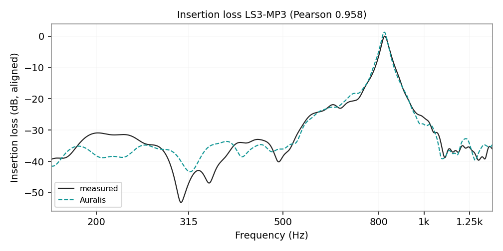
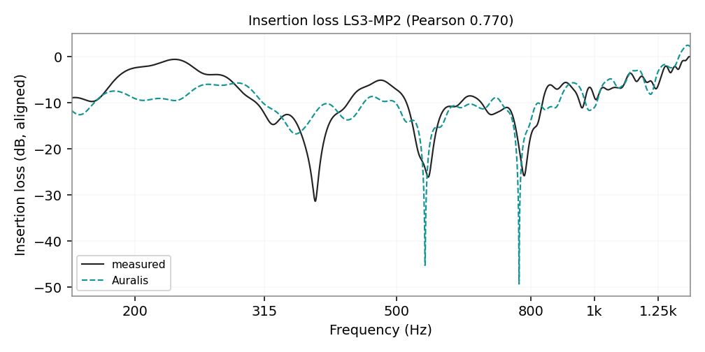
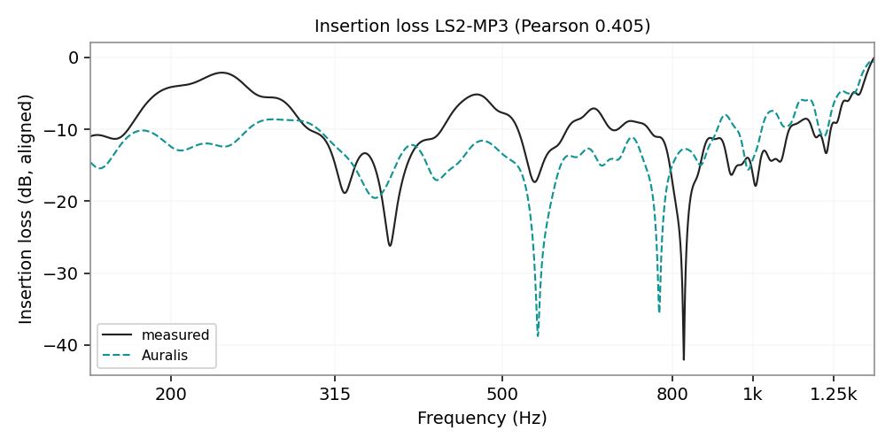

# RS6: diffraction around a finite body (scene 06)

An MDF bar (0.72 × 4.141 × 0.72 m, official BRAS OBJ) on a rigid floor, in a
hemi-anechoic chamber. 9 pairs (3 sources × 3 microphones). Source: Genelec
8020c at (0°,0°).

## Metric

BRAS measured one condition, so we judge the **insertion loss** against a
computed free field (measured Genelec directivity). Score: Pearson over
160-1400 Hz, in **third octaves** for both simulation and measurement. The
stricter narrowband and absolute TF are also given.

## Result

| Method | **IL, 1/3 oct** | TF, 1/3 oct | IL, narrowband | TF, narrowband |
|---|---|---|---|---|
| **FDTD fc=2000, anisotropic conformal** (published since 2026-11-10) | **0.84** | 0.81 | 0.71 | 0.61 |
| FDTD fc=2000, conformal off (published until 2026-11-09) | 0.84 | 0.82 | 0.71 | 0.61 |
| UTD + directivity | 0.68 | 0.62 | 0.58 | 0.49 |
| Hybrid FDTD + UTD (700 Hz) | 0.65 | 0.55 | 0.57 | 0.48 |

- The FDTD beats the UTD once the geometry is resolved (fc=2000, about 39 M
  cells, 15 min per pair). It follows the path diffracted, then reflected by
  the floor. The UTD misses it (flat curve on the LS3 pairs).
- The anisotropic conformal correction (`AURALIS_FDTD_CONFORMAL_ANISO=1`) is
  neutral here (IL 1/3 oct 0.836 against 0.840 with conformal off). It is
  better on RS7, so all open scenes use it. The default correction makes RS6
  worse (see the wave solver page of the documentation).
- Resonant walls (`RS6_PANEL=1`, optional) are neutral. The 696 mm cavity puts
  f0 at 24 Hz, below the useful band.
- Nothing is fitted on the target. Geometry and materials come from the BRAS
  dump. The speed of sound uses Cramer's formula (documented temperature and
  humidity).

Treble shows 2 pairs (LS3-MP2, LS3-MP3). In TF 1/3 oct we get **0.828**
against 0.58 ± 0.07 and **0.835** against 0.77 ± 0.05. Treble gives no
numbers, so its ranges are read off its figures.

## Open: the two LS2 pairs

7 pairs out of 9 average **0.92**. LS2-MP2 (0.65) and LS2-MP3 (0.45) pull the
total down to 0.84. Measurements ruled out walls, transmission and aiming. An
extended source does not explain them either. The Genelec first-order pattern
is neutral, and a rigid cabinet makes both pairs worse. Still open: the
measurement, or a scene detail missing from the OBJ.

## Run

Data: the official BRAS dump in `data_bras/`, scene
"RS6 diffraction (finite body)". One command replays the published
configuration (FDTD, UTD control, narrowband and third-octave insertion loss):
```bash
python3 <repo>/BRAS/RS6/run.py            # ~15 min/pair, 9 pairs
python3 <repo>/BRAS/RS6/run.py --quick    # 2 pairs, checks the chain
```
GPU recommended. Re-running resumes from the npz cache. Output: `report.txt`,
`report.csv` and the `TF_*` / `IL_*` figures.

## Files

`run.py` calls two harnesses: `rs6_diffraction_object.py` (FDTD) and
`rs6_diffraction_utd.py` (body geometry and UTD control). Figure captions are
in `figures/README.md`.

## Figures

Narrowband insertion loss (the strictest reading), published run: the best
pair, a Treble showcase pair, and the open case.




