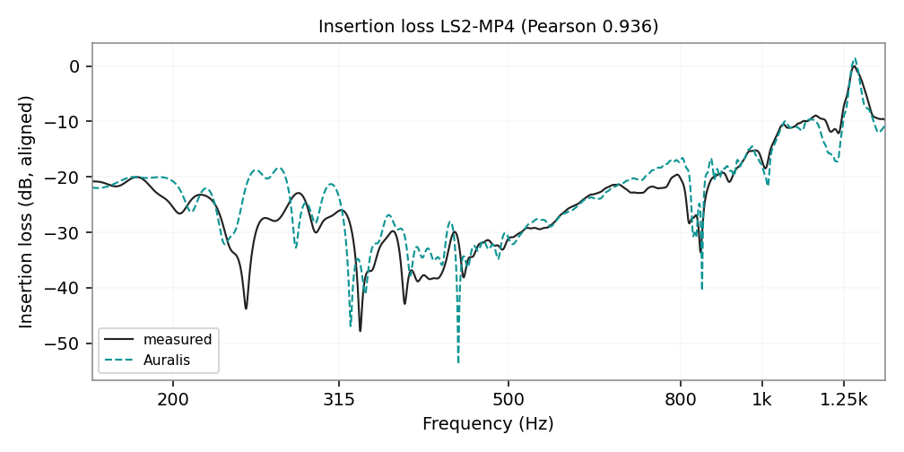
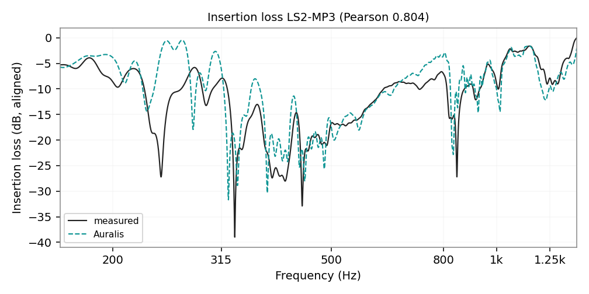
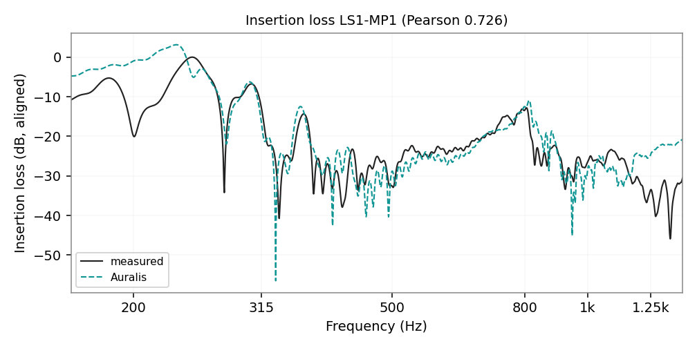
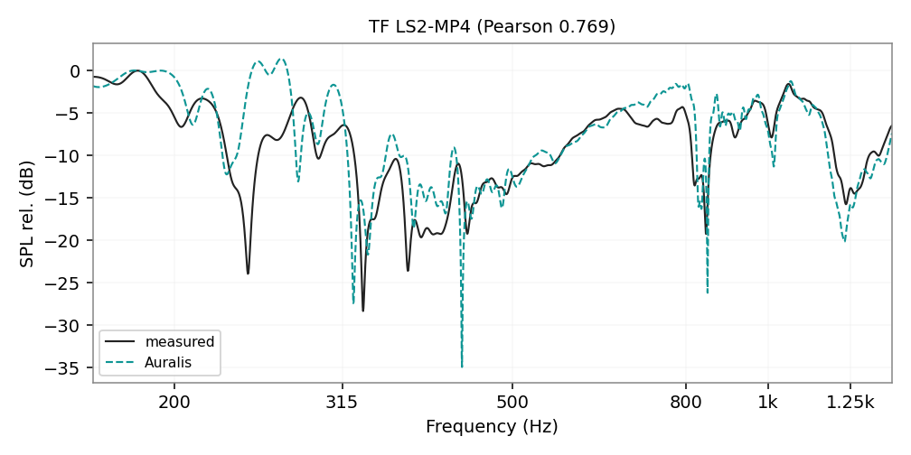

# RS7: seat-dip effect, multiple diffraction (scene 07)

An array of 15 MDF beams (0.12 × 4.14 × 0.24 m, official BRAS OBJ). The
**pitch is 0.34 m**. The "0.22" on the BRAS diagram is the free gap between
beams. Rigid floor, hemi-anechoic chamber. 8 pairs (2 Genelec × 4
microphones, 2 of them inside the array). 80 ms window, as in Treble.

## Metric

BRAS measured one condition, so we judge the **insertion loss** against a
computed free field (measured Genelec directivity). Score: Pearson over
160-1400 Hz, in **third octaves** for both simulation and measurement. The
stricter narrowband and absolute TF are also given.

## Result

| Method | **IL, 1/3 oct** | TF, 1/3 oct | IL, narrowband | TF, narrowband |
|---|---|---|---|---|
| **FDTD fc=2000, resonant, anisotropic conformal** (published since 2026-11-10) | **0.89** | 0.88 | 0.79 | 0.77 |
| FDTD fc=2000, resonant, conformal off (published until 2026-11-09) | 0.88 | 0.86 | 0.73 | 0.69 |
| UTD + directivity | 0.38 | 0.39 | 0.32 | 0.32 |
| Hybrid FDTD + UTD (700 Hz) | n/a | n/a | n/a | 0.30 |

No pair is below **0.80**. The FDTD wins everywhere, as expected for
high-order diffraction. The hybrid is a measured negative result: its UTD high
band makes it worse.

Three choices make the configuration:

- **fc=2000 is required.** The channel between beams then spans 11.6 cells.
  The 500-1400 Hz comb locks in only then. About 30 M cells, 10 min per
  pair.
- **Anisotropic conformal correction** (`AURALIS_FDTD_CONFORMAL_ANISO=1`: cut
  layer plus tangential apertures). It beats conformal off on all four
  readings over the 8 pairs (TF narrowband 0.766 against 0.691). The default
  correction makes RS7 worse (see the wave solver page of the documentation).
- **Resonant walls by default** (`RS7_NOPANEL=1` for an A/B test). The model
  is a limp panel over a 96 mm cavity, with the measured m″. Nothing is
  fitted. All 8 pairs improve.

The geometry decides this scene, not a setting. A wrong 0.22 m pitch gave
**0.01** (comb present but misaligned). The official OBJ fixed it, with no fit
on the measurement. The speed of sound is the physical one (Cramer's formula,
documented temperature and humidity), never the one that scores best.

Open: the residual over 500-1400 Hz may come from the point source. The real
source is a Genelec cabinet.

## Run

Data: the official BRAS dump in `data_bras/`, scene
"RS7 multiple diffraction (seat dip effect)". One command replays the
published configuration (FDTD, UTD control, narrowband and third-octave
insertion loss):
```bash
python3 <repo>/BRAS/RS7/run.py            # ~10 min/pair, 8 pairs
python3 <repo>/BRAS/RS7/run.py --quick    # 2 pairs, checks the chain
```
GPU recommended. Re-running resumes from the npz cache. Output: `report.txt`,
`report.csv` and the `TF_*` / `IL_*` figures.

## Files

`run.py` calls two harnesses: `rs7_seat_dip.py` (FDTD) and
`rs7_seat_dip_utd.py` (array geometry and UTD control). Run them by hand only
to explore a setting. Figure captions are in `figures/README.md`.

## Figures

Narrowband insertion loss (the strictest reading), published run: the best
pair, a typical one and the worst. Then the absolute TF, where the seat-dip
comb shows up.





