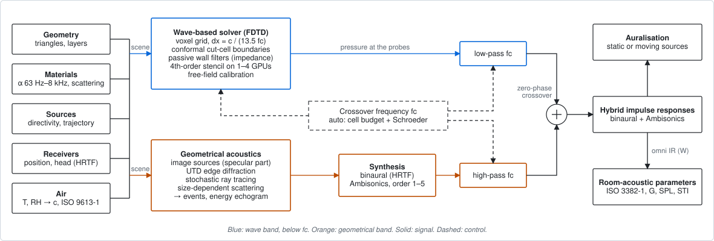
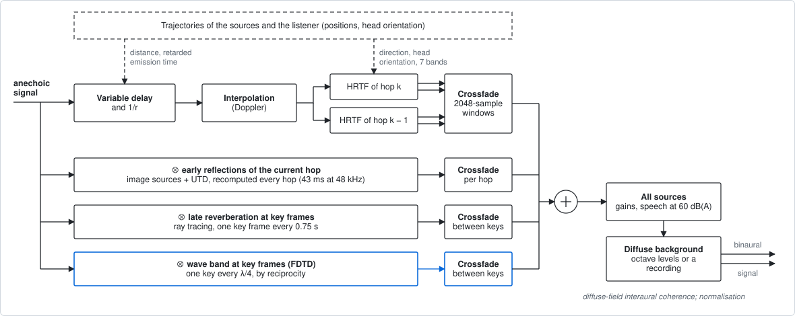
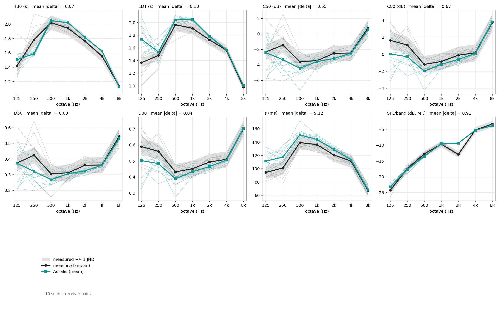

<p align="center">
  
</p>

<h1 align="center">Auralis</h1>

Auralis simulates the sound of a room and lets you listen to it. Load a
model, assign materials, and place sources and listeners. Auralis gives
binaural impulse responses, moving sources with Doppler, and ISO 3382
parameters. It is checked against laboratory measurements.

Full documentation: `docs/index.md`.

---

## How it works

Auralis splits the spectrum at a transition frequency, close to the
Schroeder frequency of the room.

| Band | Solver | What it captures |
|---|---|---|
| Low (waves) | **FDTD**, 4th order, CUDA | Modes, interference, diffraction. Wave equation on a voxel grid, walls with fitted complex admittances (Miki or measured data) |
| High (rays) | **Ray tracer and image sources (ISM)**, CUDA | Specular and diffuse reflections, scattering, UTD edge diffraction, air absorption |

Matched crossover filters join the two bands. The result is calibrated
against a free-field reference. The output is binaural (HRTF), stereo or mono. Sources can have
**measured directivities**, like the ITA dodecahedron of BRAS.



### Moving sources

Moving sources and listeners use time-varying filters:

- direct path: a variable delay line (Doppler) and cross-faded HRTFs,
- early reflections: computed again every 2048 samples (43 ms at 48 kHz),
- late reverberation and wave band: computed at key frames, cross-faded,
- plus a diffuse background.



## Results (BRAS)

Auralis is tested against **BRAS** (Benchmark for Room Acoustical
Simulation, TU Berlin). Materials come from the BRAS data. They are never
tuned to the measurements.

- Rooms (CR): mean error in JND over T30, C50, Ts and level, and the share
  of values within 1 JND.
- Other scenes: Pearson correlation with the measurement. IL is the
  insertion loss, TF the transfer function.

| Scene | Content | Result | Other reading |
|---|---|---|---|
| CR2 | Seminar room | 1.09 JND, 67 % (omni) | ears, older default: 1.15 JND, 61 % |
| CR3 | Chamber music hall | 1.51 JND, 40 % (omni) | ears, older default: 1.85 JND, 38 % |
| CR4 | Auditorium | 1.86 JND, 37 % (omni) | ears, older default: 2.06 JND, 26 % |
| CR1 | Coupled rooms, door at 30.4° / 4.1° | 3.01 JND, 26 % / 3.99 JND, 18 % | |
| RS1 | Reflection from a plane | absorber 0.658 (Treble: 0.63), diffuser 0.511 | finer grid: 0.54-0.68 and 0.22-0.26 |
| RS5 | Edge diffraction | IL 0.71 | raw TF 0.52 |
| RS6 | Finite body | IL 0.84 (third octaves) | raw TF 0.61 |
| RS7 | Seat dip | IL 0.89 (third octaves) | raw TF 0.77 |

In RS1, the Miki model of the absorber is fitted on the tube measurement
only. It predicts the oblique absorption within 0.05-0.07 in α.


*CR2, 10 source-receiver pairs. Teal: Auralis mean. Black: measured mean.
Grey: the ± 1 JND band.*

Each scene has a README with the exact commands, next to its harness
(`BRAS/<scene>/README.md`, index in `BRAS/README.md`). The metrics and the
known errors are in `docs/validation/index.md`.

## Performance

On a single RTX 2000 Ada (70 W):

- Ray tracer: **×25** faster than the multithreaded CPU engine
  (400 k rays × 200 bounces in 80 ms).
- FDTD: **≈ 2 Gcell/s** sustained. A full 10-pair CR2 run with a 600 Hz
  wave band takes **13 minutes** (an hour on the CPU).
- Everything falls back to native CPU code, then pure Python, with a clear
  message. Never silently.

## Quick start

```bash
# 1. Build the native engines (CUDA ones need nvcc)
bash native/build.sh
bash native/build_cuda.sh
bash native/build_cuda.sh --emulate

# 2. Check what was picked up
python3 -c "from auralis.engine import gpu_available, native_available; print(native_available(), gpu_available())"

# 3. Bake and listen: a furnished club, binaural IRs + convolved test signals
python3 examples/standalone_demo.py demo_out
python3 examples/demo_motion.py       # moving source, Doppler
```

Requirements: `docs/getting-started/installation.md`. Web app:
`bash webapp/start.sh` (see `webapp/README.md`).

## Licences

The code is under the MIT licence (`LICENSE`). Data has its own licences:
BRAS (CC BY-SA 4.0, `BRAS/LICENSE.md`), FABIAN head (CC BY 4.0), Odeon
(local research licence, never shared), OpenStreetMap (ODbL), Freesound and
Poly Haven (CC0). See `docs/reference/data-licences.md`.
