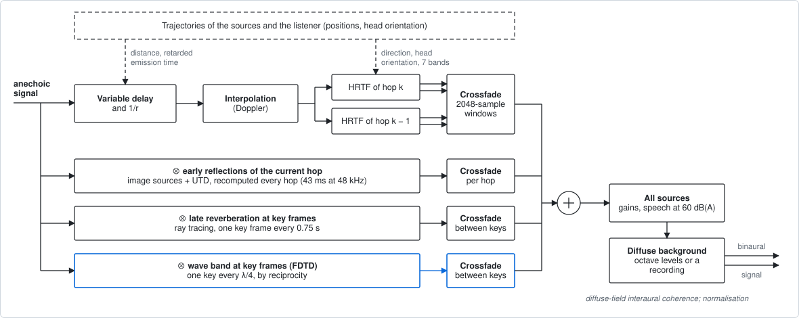

# Moving sources and listeners

An animated render plays a dry signal through a scene where the source, the
listener or both move. The response changes all the time, so Auralis cannot
use one fixed impulse response. It splits the sound into four parts.

## 1. The direct sound

The direct sound gets the most care, because the ear follows it closely.

1. **Retarded time.** At each output sample, Auralis finds when the sound
   left the source. It uses the source position at that earlier time.
2. **Variable delay and 1/r.** The signal is read with that delay and
   divided by the distance.
3. **Interpolation.** The delay is not a whole number of samples. The signal
   is read between samples. The Doppler shift comes from this changing delay.
   No separate pitch shift is needed.
4. **HRTF.** The output is cut into hops of 2048 samples (43 ms at 48 kHz),
   with overlapping windows. Each hop gets the HRTF of the current direction,
   with the source directivity and the air absorption. The overlap
   cross-fades from one HRTF to the next.

## 2. Early reflections

At every hop, Auralis computes the image sources and the diffraction paths
for the current positions. It convolves the windowed signal with this early
response. The windows overlap, so the result is smooth.

## 3. Late reverberation

The late field changes slowly. Auralis traces rays at key frames, every
0.75 s by default. It convolves the signal with the late response of each key
frame and cross-fades between key frames.

## 4. The wave band

With the wave solver, the low band is computed at key frames too.

- The key frames are close enough that the path moves by at most a quarter
  or an eighth of a wavelength at fc between them.
- If only the source moves, the listener's ears are fixed. Auralis uses
  reciprocity: it puts the source at each ear and records at the source
  positions. Two runs (one per ear) serve every key of the source.
- If only the listener moves, one run per source records the ears along the
  listener's path.
- If both move, there are two runs per key frame of the listener. A large
  scene may need hundreds of runs. A cap stops this on a laptop, with a
  warning.

The geometrical render is high-passed at fc, and the wave band is low-passed
and cross-faded.

## Mixing

- All sources are summed with their gains.
- When a background is set, each track is first set to the level of speech at
  1 m (60 dB(A) for normal effort).
- A diffuse background is added: octave levels or a recording. The two ears
  get it with the coherence of a diffuse field.
- The result is normalised and written as a WAV file. The credits of the
  recordings and of the head go into a text file next to it.
