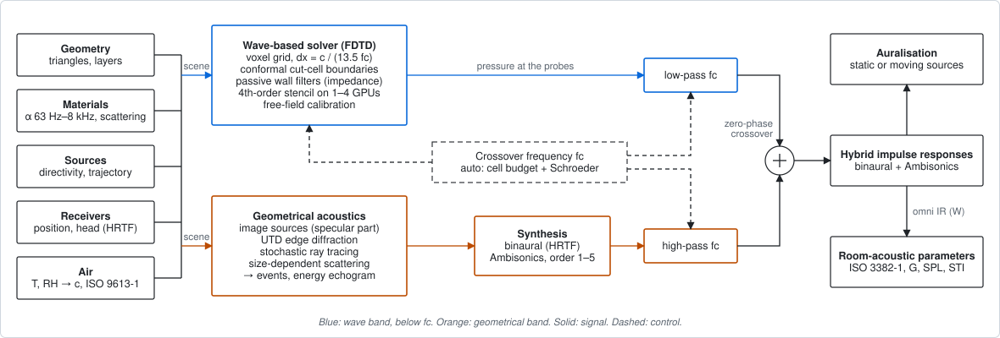

# Overview

Auralis computes impulse responses with two solvers and joins them.

## Why two solvers

Geometrical acoustics treats sound as rays. This is accurate when the
wavelength is small compared with the room and its surfaces. At low
frequencies it is not. Sound bends around objects, rooms have separate modes,
and waves interfere. A ray model misses all of this.

A wave solver gets these effects right, but its cost grows with the fourth
power of the frequency. Solving the whole audible range with waves is not
practical for a room.

So Auralis uses each method where it works:

| Band | Solver | Captures |
|---|---|---|
| Below the transition frequency fc | Wave-based solver (FDTD) | Modes, interference, diffraction, the phase of wall reflections |
| Above fc | Geometrical acoustics | Specular and diffuse reflections, edge diffraction, air absorption |

## The steps of a run

1. **Scene.** The model, its materials, the sources, the receivers and the
   air.
2. **Wave band.** The FDTD solver builds a grid of cells, injects an impulse
   at the source and records the pressure at the receivers. See
   {doc}`wave-solver`.
3. **Geometrical band.** Image sources, edge diffraction and stochastic ray
   tracing give a list of sound events and an energy histogram (the
   echogram). A synthesis step turns them into binaural and Ambisonics
   responses. See {doc}`geometrical-solver`.
4. **Crossover.** The wave band goes through a low-pass filter at fc, the
   geometrical band through a high-pass filter. The two filters add up to one.
   The sum is the hybrid response. See {doc}`hybrid`.
5. **Parameters.** ISO 3382-1 parameters, G, SPL and STI come from the
   omnidirectional response.
6. **Auralisation.** The responses are convolved with dry sound, for a fixed
   or moving listener. See {doc}`moving-sources` and
   {doc}`binaural-ambisonics`.

## Hardware

Both solvers run on NVIDIA GPUs with CUDA. They also run on the CPU with a C++
library, and in pure Python as a last resort. The engine always says which one
it uses. If it has to fall back to slower code, it prints a clear message.

## Design rules

These rules guide every change to the engine.

- **Measure before you change.** A change must show a measured gain.
- **Never fit to the target.** Materials and settings come from the input
  data, never from the measurements used for validation.
- **No silent fallback.** When something degrades, the engine says so.
- **Stay exact against references.** Every faster code path must give the
  same numbers as the reference code, bit for bit where possible.
