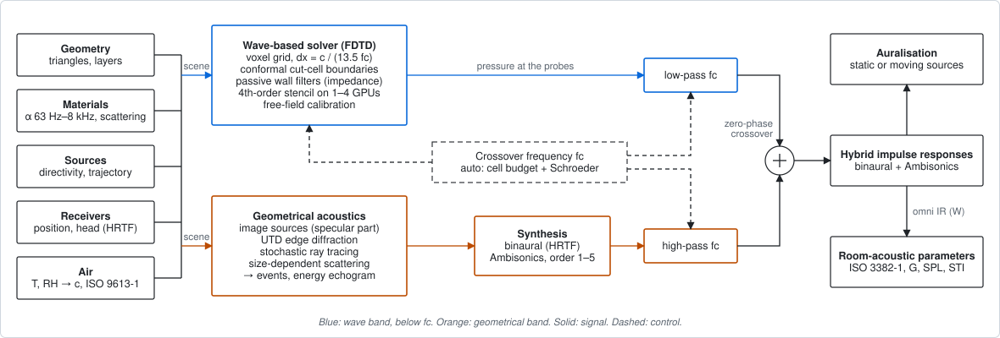

# Auralis

Auralis is a room acoustics engine. It simulates how sound travels in a room
or a street, and it lets you listen to the result.

You give Auralis a 3D model, materials, sources and listeners. Auralis
computes impulse responses for every source and listener pair. From these
responses it gives room acoustic parameters (reverberation time, clarity,
strength, speech intelligibility) and binaural sound for headphones.



## Two solvers in one engine

Sound behaves like a wave at low frequencies and more like rays at high
frequencies. Auralis uses one solver for each case.

- Below a transition frequency, a **wave-based solver** (FDTD) solves the
  wave equation on a grid. It captures room modes, interference and
  diffraction.
- Above it, a **geometrical acoustics solver** follows reflections with image
  sources and rays. It is fast and it covers the whole audible range.

Auralis joins the two results with a crossover filter. The result is one
hybrid impulse response.

## What you can do with it

- Import a room model (OBJ, Odeon, DXF, Rhino, IFC, SketchUp).
- Assign materials from built-in libraries or your own data.
- Place sources with real directivities, and listeners with a measured head.
- Run the simulation on a GPU or on the CPU.
- Read ISO 3382 parameters, STI, maps and curves.
- Listen with head tracking, or render moving sources with the Doppler effect.
- Script everything in Python.

Auralis is checked against the BRAS database of room acoustic measurements.
See {doc}`validation/index`.

```{figure} images/example-paris.jpg
:alt: The Auralis web app showing a Paris street in 3D, with its sources
:width: 100%

The web app with the Paris street example, built from OpenStreetMap.
```

```{toctree}
:maxdepth: 2
:caption: Getting started

getting-started/installation
getting-started/quickstart
getting-started/web-app
```

```{toctree}
:maxdepth: 2
:caption: User guide

user-guide/models
user-guide/materials
user-guide/sources-receivers
user-guide/simulation-settings
user-guide/results
user-guide/listening
user-guide/examples
```

```{toctree}
:maxdepth: 2
:caption: How the engine works

engine/overview
engine/wave-solver
engine/geometrical-solver
engine/hybrid
engine/moving-sources
engine/binaural-ambisonics
engine/large-scenes
```

```{toctree}
:maxdepth: 2
:caption: Python

scripting/python-api
scripting/manifests
scripting/api-reference
```

```{toctree}
:maxdepth: 2
:caption: Validation

validation/index
```

```{toctree}
:maxdepth: 2
:caption: Reference

reference/settings
reference/environment
reference/troubleshooting
reference/data-licences
reference/glossary
```
